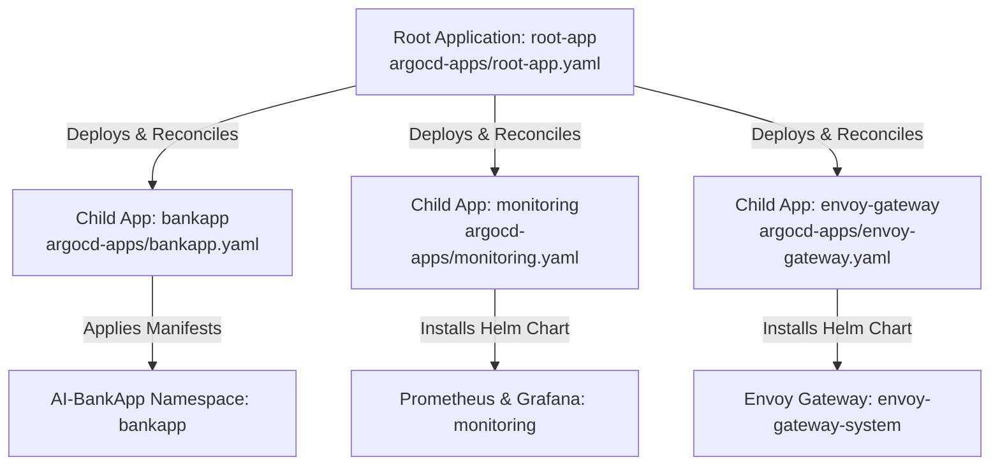

# Day 85: ArgoCD Deep Dive – Sync Strategies, Rollbacks, and Multi-App Management

Understanding advanced GitOps patterns in ArgoCD: sync strategies, resource ordering via sync waves, rollback workflows, the App of Apps pattern for multi-app management, automated notifications, and multi-tenant project isolation with RBAC.

---

## Prerequisites & Setup Details

Before executing the tasks, verify the following configuration baseline:

* **EKS Cluster & ArgoCD Status:** Day 84's deployment of the `AI-BankApp` must remain running on the AWS EKS cluster.
* **Target Branch & Repository:** All manifest updates and new application manifests must be committed to branch `feat/gitops` on your fork: `[https://github.com/NB11-ML/AI-BankApp-DevOps.git](https://github.com/NB11-ML/AI-BankApp-DevOps.git)`.
* **ArgoCD CLI Authenticated:** Ensure the `argocd` CLI is logged in to your server instance:
```bash
# Retrieve admin password if needed
kubectl -n argocd get secret argocd-initial-admin-secret -o jsonpath="{.data.password}" | base64 -d && echo

# Login via CLI (or port-forward localhost:8080)
argocd login <ARGOCD_SERVER_URL> --username admin --insecure

```


---

## Task 1: Understand Sync Strategies (Automated vs. Manual)

ArgoCD supports both declarative automated synchronization and review-gated manual synchronization.

### Sync Strategy Comparison

| Feature | Automated Sync (`syncPolicy.automated`) | Manual Sync (`syncPolicy: {}`) |
| --- | --- | --- |
| **Primary Environment** | Development, QA, Staging | Production, Regulated Environments |
| **Drift Correction** | Automatically applies changes within reconciliation loops (~3 mins). | Detects drift and flags `OutOfSync`; requires manual action. |
| **Approval Gate** | None. Git commit/merge directly triggers cluster mutation. | Strict human gate required via UI or CLI (`argocd app sync`). |
| **Self-Healing (`selfHeal`)** | Can revert ad-hoc `kubectl` cluster tampering automatically. | Live cluster alterations persist until an operator triggers sync. |
| **Pruning (`prune`)** | Automatically deletes Kubernetes objects removed from Git. | Orphaned resources remain until manual sync with prune option. |
| **Safety Previews** | Changes apply immediately upon polling. | Full diff inspection via `argocd app diff` before applying. |

### Step-by-Step Execution: Testing Manual Sync with Previews

1. **Disable automated synchronization on the application:**
```bash
argocd app set bankapp --sync-policy none

```


2. **Trigger configuration drift in Git:**
Edit `k8s/configmap.yml` on the `feat/gitops` branch. Update the `APP_NAME` or add a metadata label:
```yaml
apiVersion: v1
kind: ConfigMap
metadata:
  name: bankapp-config
  namespace: bankapp
data:
  APP_NAME: "AI-BankApp-Production-Preview"
  ENVIRONMENT: "production"

```


Commit and push the modification to GitHub:
```bash
git add k8s/configmap.yml
git commit -m "feat(config): update app config to trigger manual sync drift"
git push origin feat/gitops

```


3. **Verify drift detection without auto-reconciliation:**
Wait for the 3-minute poll interval (or trigger a refresh via `argocd app get bankapp --refresh`). Confirm the application reports `OutOfSync`:
```bash
argocd app get bankapp

```


4. **Inspect the diff between Git and cluster state:**
```bash
argocd app diff bankapp

```


5. **Execute a dry-run preview:**
```bash
argocd app sync bankapp --dry-run

```


6. **Apply the sync manually:**
```bash
argocd app sync bankapp

```


7. **Restore automated synchronization and self-healing:**
```bash
argocd app set bankapp --sync-policy automated --self-heal --auto-prune

```


---

## Task 2: Sync Waves and Resource Ordering

In microservice architectures, dependency ordering is critical: storage and namespaces must precede configurations, configurations must precede databases, and databases must be healthy before application pods start.

ArgoCD achieves this using the annotation:

```yaml
argocd.argoproj.io/sync-wave: "<integer>"

```

* Waves are executed in ascending numerical order (negative to positive).
* Resources within the same wave are deployed concurrently.
* ArgoCD pauses and waits for all resources in a wave to achieve a `Healthy` state before initiating the next wave.

### AI-BankApp Sync Wave Architecture

| Wave | Resources | Tier | Purpose |
| --- | --- | --- | --- |
| **-2** | `k8s/namespace.yml`, `k8s/pv.yml` (StorageClass) | Infrastructure | Provisions namespace isolation and storage backends. |
| **-1** | `k8s/pvc.yml`, `k8s/configmap.yml`, `k8s/secrets.yml` | Configuration & Storage | Ensures persistent volumes, configs, and credentials exist. |
| **0** | `k8s/mysql-deployment.yml`, `k8s/ollama-deployment.yml`, `k8s/service.yml` | Data & Internal Mesh | Starts database, LLM backend, and binds cluster networking. |
| **1** | `k8s/bankapp-deployment.yml` | Application Layer | Boots Spring Boot pods after MySQL/Ollama readiness. |
| **2** | `k8s/hpa.yml` | Autoscaling | Attaches horizontal autoscaler after deployment stabilizes. |

### Manifest Annotations Added

Add the corresponding annotations to each manifest in your fork:

* **`k8s/namespace.yml`:**
```yaml
apiVersion: v1
kind: Namespace
metadata:
  name: bankapp
  annotations:
    argocd.argoproj.io/sync-wave: "-2"

```


* **`k8s/pv.yml` (StorageClass):**
```yaml
apiVersion: storage.k8s.io/v1
kind: StorageClass
metadata:
  name: gp3
  annotations:
    argocd.argoproj.io/sync-wave: "-2"
provisioner: ebs.csi.aws.com
volumeBindingMode: WaitForFirstConsumer

```


* **`k8s/pvc.yml` (App & DB PVCs):**
```yaml
metadata:
  annotations:
    argocd.argoproj.io/sync-wave: "-1"

```


* **`k8s/configmap.yml` & `k8s/secrets.yml`:**
```yaml
metadata:
  annotations:
    argocd.argoproj.io/sync-wave: "-1"

```


* **`k8s/mysql-deployment.yml` & `k8s/ollama-deployment.yml`:**
```yaml
metadata:
  annotations:
    argocd.argoproj.io/sync-wave: "0"

```


* **`k8s/service.yml` (All services):**
```yaml
metadata:
  annotations:
    argocd.argoproj.io/sync-wave: "0"

```


* **`k8s/bankapp-deployment.yml`:**
```yaml
metadata:
  annotations:
    argocd.argoproj.io/sync-wave: "1"

```


* **`k8s/hpa.yml`:**
```yaml
metadata:
  annotations:
    argocd.argoproj.io/sync-wave: "2"

```


Commit and push these changes to GitHub:

```bash
git add k8s/
git commit -m "feat(gitops): add sync-wave annotations for phased deployment order"
git push origin feat/gitops

```


---

## Task 3: ArgoCD Rollbacks vs. Git Revert

ArgoCD records each synchronization phase as a distinct revision ID containing the commit SHA, timestamp, and deployment status.

### 1. View Sync History

```bash
argocd app history bankapp

```


Example Output:

```text
ID  DATE                  REVISION
1   2026-10-13 18:51:10   d37fe11
2   2026-10-13 19:46:14   f82b9a4   (sync wave annotations)

```

### 2. Execute an ArgoCD Rollback

Rollback to revision 1 via CLI:

```bash
argocd app rollback bankapp 17

```


*(Alternatively, via the UI: Navigate to `bankapp` > **History and Rollback** > select Revision 1 > click **Rollback**).*

Verify the application status after rollback:

```bash
argocd app get bankapp

```


*Result:* The cluster workloads run revision 17, but the application status displays **`OutOfSync`**.

---

### Architectural Analysis: ArgoCD Rollback vs. Git Revert

#### ArgoCD Rollback (Imperative Cluster Mutation)

* **Mechanism:** Instructs the ArgoCD application controller to temporarily apply a previous deployment manifest cached in etcd directly to the Kubernetes cluster.
* **Impact on Git:** None. The Git repository remains at `HEAD` (the broken commit).
* **GitOps Conflict:** Because Git no longer reflects live cluster state, automated sync must be disabled. If self-healing or automated sync is turned on, ArgoCD will immediately overwrite the rollback and re-deploy the broken `HEAD` commit.
* **Classification:** Temporary emergency fix to restore uptime while a permanent fix is prepared.

#### Git Revert (Declarative GitOps Reversal)

* **Mechanism:** Creates an explicit reverse commit in the Git repository:
```bash
git revert HEAD
git push origin feat/gitops

```


* **Impact on Git:** Appends a new commit that reverts the changes made in the problematic commit, leaving the repository history fully auditable.
* **GitOps Alignment:** ArgoCD detects the new Git commit, marks the application as progressing, and safely reconciles the cluster to the older configuration while keeping the application **`Synced`** and self-healing active.
* **Classification:** The only strictly correct GitOps deployment procedure.

---

## Task 4: The App of Apps Pattern

The **App of Apps** pattern uses a single root ArgoCD Application that points to a Git directory containing other ArgoCD `Application` manifests. Managing the root app automatically creates, updates, and deletes child applications declaratively.

### Architecture Diagram



### Directory Setup & Manifest Implementation

Create the directory structure:

```bash
mkdir -p argocd-apps/

```

#### 1. Child Application: BankApp (`argocd-apps/bankapp.yaml`)

```yaml
apiVersion: argoproj.io/v1alpha1
kind: Application
metadata:
  name: bankapp
  namespace: argocd
  finalizers:
    - resources-finalizer.argocd.argoproj.io
spec:
  project: default
  source:
    repoURL: https://github.com/NB11-ML/AI-BankApp-DevOps.git
    targetRevision: feat/gitops
    path: k8s
  destination:
    server: https://kubernetes.default.svc
    namespace: bankapp
  syncPolicy:
    automated:
      prune: true
      selfHeal: true
    syncOptions:
      - CreateNamespace=true
      - ServerSideApply=true

```

#### 2. Child Application: Monitoring Stack (`argocd-apps/monitoring.yaml`)

```yaml
apiVersion: argoproj.io/v1alpha1
kind: Application
metadata:
  name: monitoring
  namespace: argocd
  finalizers:
    - resources-finalizer.argocd.argoproj.io
spec:
  project: default
  source:
    repoURL: https://prometheus-community.github.io/helm-charts
    chart: kube-prometheus-stack
    targetRevision: "65.*"
    helm:
      values: |
        grafana:
          adminPassword: admin123
        prometheus:
          prometheusSpec:
            retention: 3d
            resources:
              requests:
                memory: 256Mi
                cpu: 100m
  destination:
    server: https://kubernetes.default.svc
    namespace: monitoring
  syncPolicy:
    automated:
      prune: true
      selfHeal: true
    syncOptions:
      - CreateNamespace=true
      - ServerSideApply=true

```

#### 3. Child Application: Envoy Gateway (`argocd-apps/envoy-gateway.yaml`)

```yaml
apiVersion: argoproj.io/v1alpha1
kind: Application
metadata:
  name: envoy-gateway
  namespace: argocd
  finalizers:
    - resources-finalizer.argocd.argoproj.io
spec:
  project: default
  source:
    repoURL: docker.io/envoyproxy
    chart: gateway-helm
    targetRevision: "v1.4.*"
  destination:
    server: https://kubernetes.default.svc
    namespace: envoy-gateway-system
  syncPolicy:
    automated:
      prune: true
      selfHeal: true
    syncOptions:
      - CreateNamespace=true

```

#### 4. Parent Application: Root Application (`argocd-apps/root-app.yaml`)

```yaml
apiVersion: argoproj.io/v1alpha1
kind: Application
metadata:
  name: root-app
  namespace: argocd
spec:
  project: default
  source:
    repoURL: https://github.com/NB11-ML/AI-BankApp-DevOps.git
    targetRevision: feat/gitops
    path: argocd-apps
  destination:
    server: https://kubernetes.default.svc
    namespace: argocd
  syncPolicy:
    automated:
      prune: true
      selfHeal: true

```

### Deployment and Verification

1. **Commit and push manifests to your fork:**
```bash
git add argocd-apps/
git commit -m "feat(gitops): implement App of Apps pattern for multi-app management"
git push origin feat/gitops

```


2. **Deploy the root application:**
```bash
kubectl apply -f argocd-apps/root-app.yaml

```


3. **Verify the applications in the CLI:**
```bash
argocd app list

```


*Output:*
```text
NAME           CLUSTER                         NAMESPACE             PROJECT  STATUS  HEALTH   SYNCPOLICY
root-app       https://kubernetes.default.svc  argocd                default  Synced  Healthy  Auto-Prune
bankapp        https://kubernetes.default.svc  bankapp               default  Synced  Healthy  Auto-Prune
envoy-gateway  https://kubernetes.default.svc  envoy-gateway-system  default  Synced  Healthy  Auto-Prune
monitoring     https://kubernetes.default.svc  monitoring            default  Synced  Healthy  Auto-Prune

```


---

## Task 5: ArgoCD Notifications

ArgoCD Notifications monitors application events and forwards formatted alerts to Slack, email, or webhook destinations.

### 1. Verify Notifications Controller

```bash
kubectl get pods -n argocd -l app.kubernetes.io/component=notifications-controller

```

### 2. Configure Triggers and Templates

Create the notification configuration ConfigMap:

```bash
kubectl apply -n argocd -f - <<'EOF'
apiVersion: v1
kind: ConfigMap
metadata:
  name: argocd-notifications-cm
  namespace: argocd
data:
  trigger.on-sync-succeeded: |
    when: app.status.operationState.phase in ['Succeeded']
    send: [app-sync-succeeded]

  trigger.on-sync-failed: |
    when: app.status.operationState.phase in ['Error', 'Failed']
    send: [app-sync-failed]

  trigger.on-health-degraded: |
    when: app.status.health.status == 'Degraded'
    send: [app-health-degraded]

  template.app-sync-succeeded: |
    message: "Application {{.app.metadata.name}} sync succeeded. Revision: {{.app.status.sync.revision}}"

  template.app-sync-failed: |
    message: "Application {{.app.metadata.name}} sync FAILED! Check ArgoCD for details."

  template.app-health-degraded: |
    message: "Application {{.app.metadata.name}} health is DEGRADED. Investigate immediately."
EOF

```

### 3. Subscribe the Application to Triggers

Annotate the `bankapp` application to receive alerts:

```bash
kubectl annotate application bankapp -n argocd \
  notifications.argoproj.io/subscribe.on-sync-succeeded.webhook="" \
  notifications.argoproj.io/subscribe.on-sync-failed.webhook="" \
  notifications.argoproj.io/subscribe.on-health-degraded.webhook="" --overwrite

```

### 4. Verify Notification Processing

Inspect the application state message to verify event handling:

```bash
kubectl get applications bankapp -n argocd -o jsonpath='{.status.operationState.message}' && echo

```


---

## Task 6: ArgoCD Projects and RBAC (Multi-Tenancy)

In enterprise Kubernetes clusters, multi-tenancy requires strict resource boundaries. ArgoCD **Projects** isolate *what* and *where* applications deploy, while **RBAC** dictates *who* can manage those deployments.

### 1. Create a Restricted Project

Create the `bankapp-team` project scoped strictly to our repository and namespaces:

```bash
argocd proj create bankapp-team \
  --description "AI-BankApp team project" \
  --src "https://github.com/NB11-ML/AI-BankApp-DevOps.git" \
  --dest "https://kubernetes.default.svc,bankapp" \
  --dest "https://kubernetes.default.svc,monitoring"

```

### 2. Bind the Application to the Project

```bash
argocd app set bankapp --project bankapp-team

```

### 3. Verify Project Isolation

Verify that the project denies deploying to protected cluster namespaces:

```bash
argocd proj add-destination bankapp-team https://kubernetes.default.svc kube-system 2>&1 || echo "Restricted!"

```


### 4. Configure Role-Based Access Control (RBAC)

Update the `argocd-rbac-cm` ConfigMap to enforce least privilege:

```bash
kubectl apply -n argocd -f - <<'EOF'
apiVersion: v1
kind: ConfigMap
metadata:
  name: argocd-rbac-cm
  namespace: argocd
data:
  policy.csv: |
    p, role:bankapp-dev, applications, get, bankapp-team/*, allow
    p, role:bankapp-dev, applications, sync, bankapp-team/*, allow
    p, role:bankapp-dev, applications, rollback, bankapp-team/*, deny
    g, bankapp-developers, role:bankapp-dev
EOF

```


---

### Architectural Analysis: How Projects and RBAC Protect Multi-Tenant Clusters

1. **Blast Radius Isolation (Projects):**
* **Source Whitelisting:** Prevents malicious or unvetted Git repositories from running code on the cluster. The project explicitly permits only `[https://github.com/NB11-ML/AI-BankApp-DevOps.git](https://github.com/NB11-ML/AI-BankApp-DevOps.git)`.
* **Destination Scoping:** Disallows deploying manifests into system namespaces like `kube-system`, `kube-public`, or other tenants' environments.
* **Resource Denylisting:** Restricts creation of cluster-scoped resources like `ClusterRoleBinding` or `StorageClass`, containing the application team's scope within their namespace.


2. **Access Control & Governance (RBAC):**
* **Action-Level Permissions:** Developers in group `bankapp-developers` receive permissions to inspect (`get`) and trigger reconciliations (`sync`).
* **Destructive Command Restrictions:** The explicit `deny` policy on `rollback` prevents junior engineers from overriding version-controlled Git states with cached revisions during incidents, requiring escalation to senior SREs.
* **Zero Lateral Movement:** Policies evaluate the project scope (`bankapp-team/*`), preventing a user with credentials for the banking application from viewing or mutating applications in other namespaces or projects.
